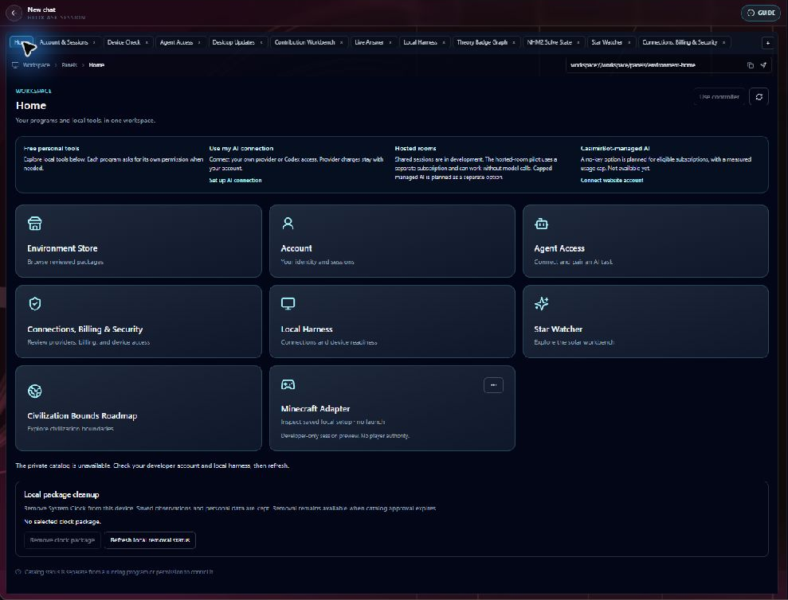

# CasimirBot

CasimirBot is a Windows research workstation and environment harness for working with AI inside real software. Its desktop brings together scientific tools, evidence views, account and connection checkpoints, and governed links to external programs. A supported AI client can inspect an admitted capability, receive an observation, and request a bounded operation when the account, program owner, and connector allow it.

The [website](https://casimirbot.com/) handles CasimirBot account identity and public release information. The [download page](https://casimirbot.com/download) is the source for the signed Windows installer and its current publisher and checksum. The desktop screenshots on this page come from a separate **R173 isolated private developer build**. They show the design and current test workflow; they are not evidence that the public installer exposes every panel or that every connection is ready.

## How a workflow proceeds

1. **Open the desktop and check identity.** Account & Sessions shows whether the website account is connected to this installation. Website sign-in alone does not grant AI, room, device, or program authority.
2. **Choose the AI connection.** Agent Access separates local setup, OAuth or protected client presence, exact task pairing, tool catalog, and required tool checks. A person can use bounded personal tools without a hosted-room subscription; a Message Codex task connection has its own owner-approved pairing.
3. **Check the environment.** Device Check shows connector identity, freshness, and local readiness. A Ready tunnel or supervisor does not prove that a remote client has authenticated, a device is paired, or an effect is allowed.
4. **Ask for an observation or bounded action.** The AI client selects an available capability. CasimirBot checks identity, context, consent, and scope, then returns an observation or a typed result with postcondition evidence. Where a prerequisite is missing, the workflow should report that failure rather than inventing a successful action.
5. **Inspect the evidence.** Research panels distinguish inputs, diagnostic models, calculated results, and verification receipts. A badge or screenshot does not establish a physical result.

The R173 Agent Access crop shows a real checkpoint state: the selected Personal Codex local entry reported `build_unavailable`, with the protected client read unverified. Saved pairing history and a locally Ready tunnel are separate from that selected route. The private conversation and pairing details are excluded from the image.

## What people can explore

The Home view groups **free personal tools**, **your AI connection**, **hosted rooms**, and a planned CasimirBot-managed AI path. Hosted collaboration and managed AI have separate release and account conditions. The workstation also contains research views such as Star Watcher, Theory Badge Graph, and Contribution Workbench.

The R173 Contribution Workbench crop shows a blank draft: a researcher can choose a node and truth stage, describe a contribution, and stage evidence and review notes. **Run verification** is disabled in this pictured state. The image is not a verification receipt or an accepted scientific claim.

CasimirBot's warp and propulsion studies are research and simulation. This page makes no claim of a working propulsion device. Minecraft is a technical reference environment for connector development; showing its code or setup path does not grant game actions or establish an approved paid Minecraft feature.

## Open source and the private platform repository

The historical full-platform repository remains private while its reachable history, imported material, credentials and runtime data, and file rights are reviewed. The current approach publishes reviewed first-party components from clean histories, with exact source inventories and component licenses. These public repositories are available now:

| Public repository | Scope |
| --- | --- |
| [Environment connector kit](https://github.com/pestypig/casimirbot-environment-connector-kit) | MIT-licensed contracts, transport helpers, synthetic and read-only examples, and mock. |
| [Verifier source](https://github.com/pestypig/casimirbot-verifier-source) | MIT-licensed Shadow of Intent SDK, CLI, and scaffolder source. |
| [Shared TypeScript preview](https://github.com/pestypig/casimirbot-shared-source-preview) | Selected shared contracts, policies, research metadata, and tests. |
| [Desktop host preview](https://github.com/pestypig/casimirbot-desktop-source-preview) | Selected Electron host and native Windows clock bridge source. |
| [Web-client preview](https://github.com/pestypig/casimirbot-web-client-source-preview) | Selected React/TypeScript UI and tests. |
| [Discord preview](https://github.com/pestypig/casimirbot-discord-source-preview) | Selected transport and voice-worker source. |

Each source repository describes its own build limits and third-party notices. The larger source-only previews are for inspection and reuse, not independently runnable CasimirBot installations. The public [Agent Access guide](https://casimirbot.com/agent-access) describes supported account-scoped connections; [public reasoning context](https://casimirbot.com/llms.txt) can be read without a private connection.

This repository is a **platform overview, not the application source or installer**. Its screenshots are illustrative product captures and are not covered by the MIT code licenses in the linked source repositories.
