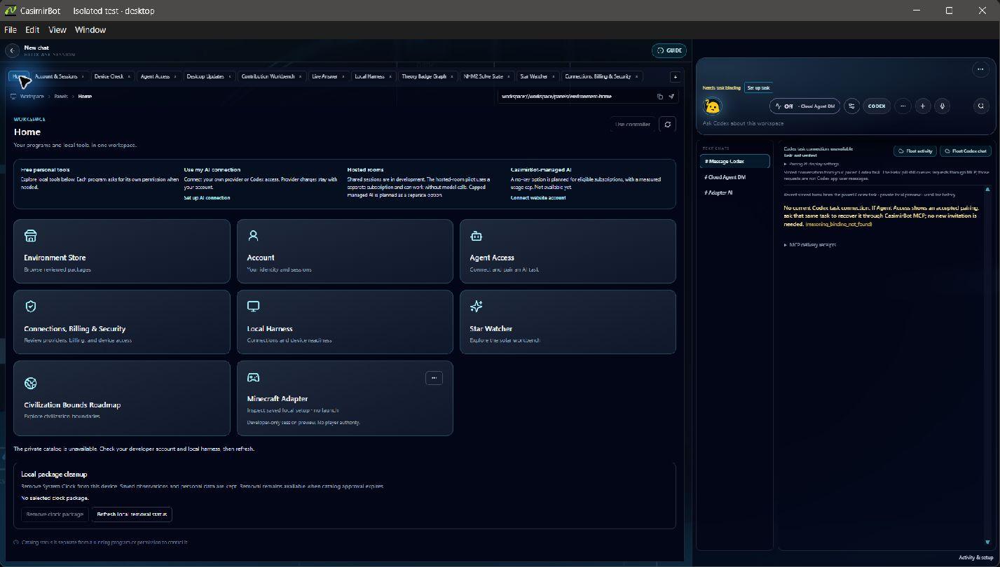
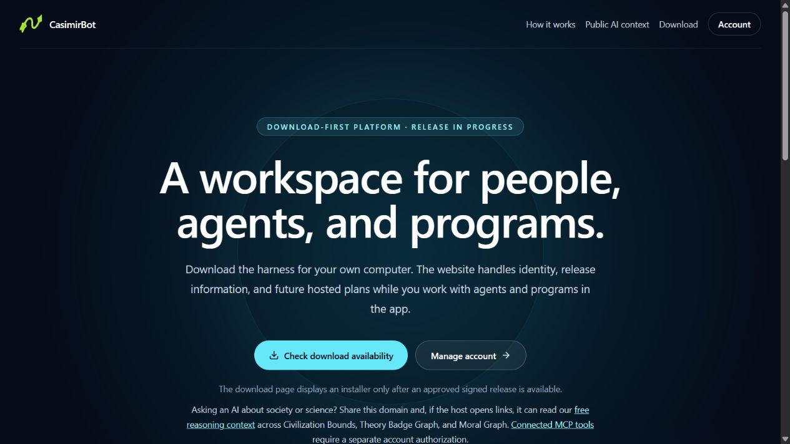
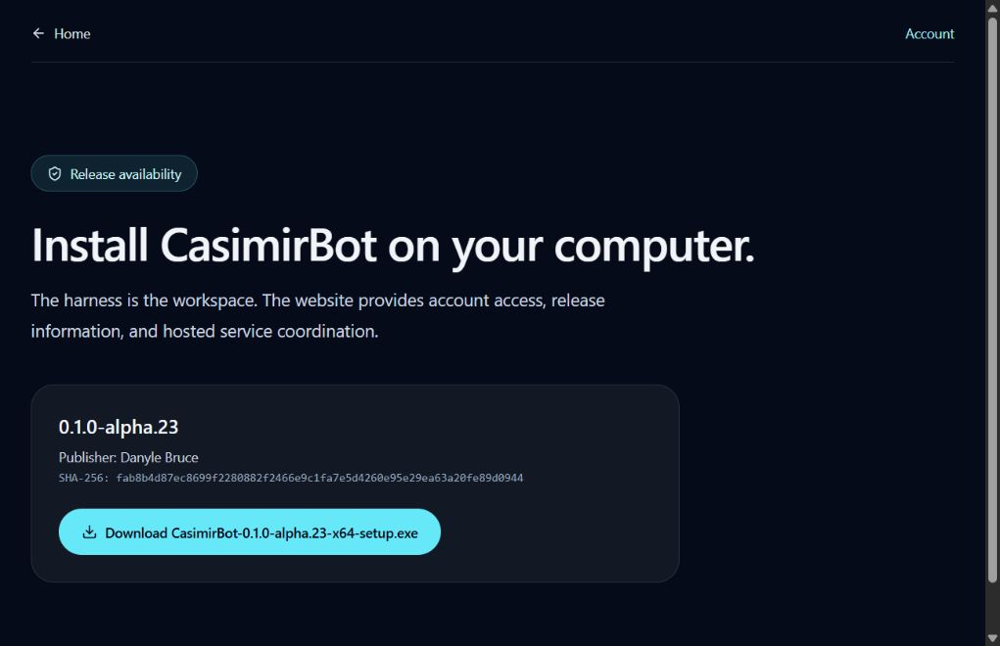
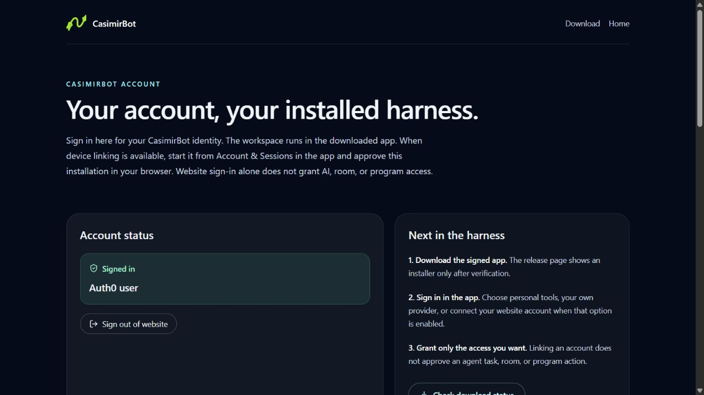
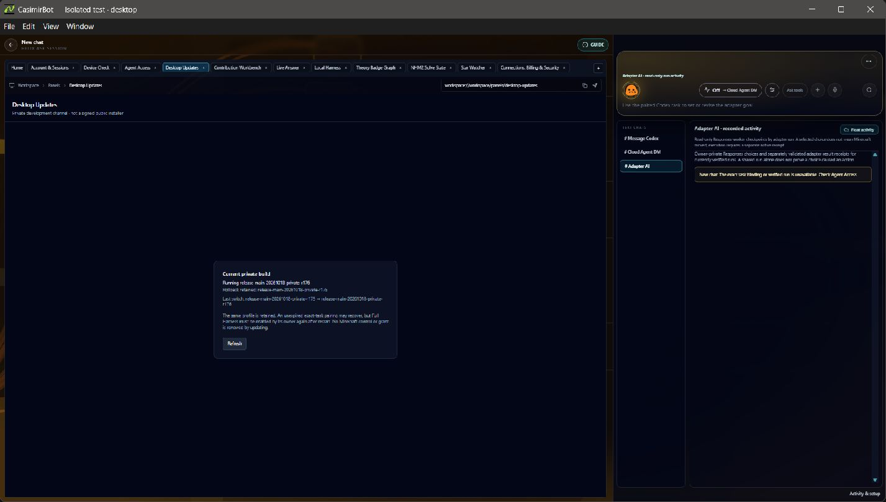
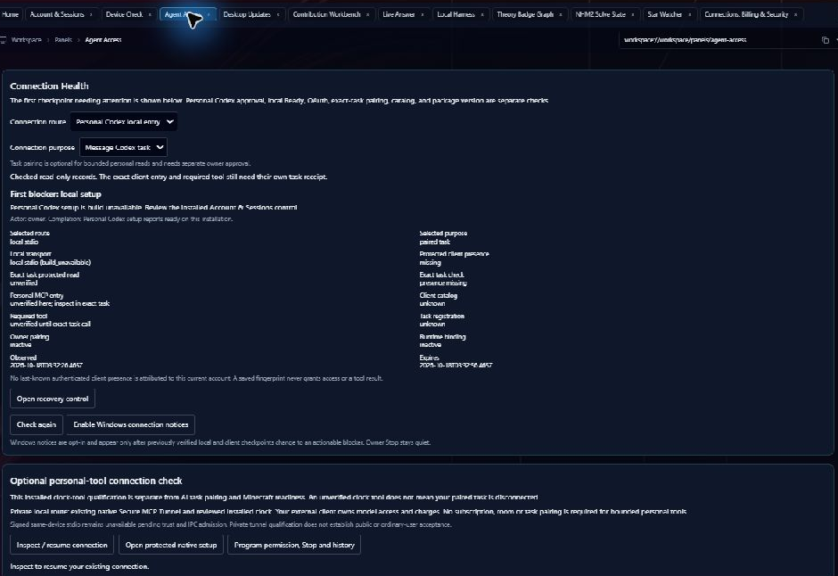
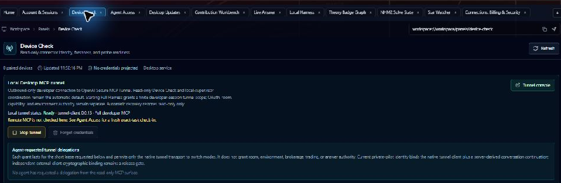
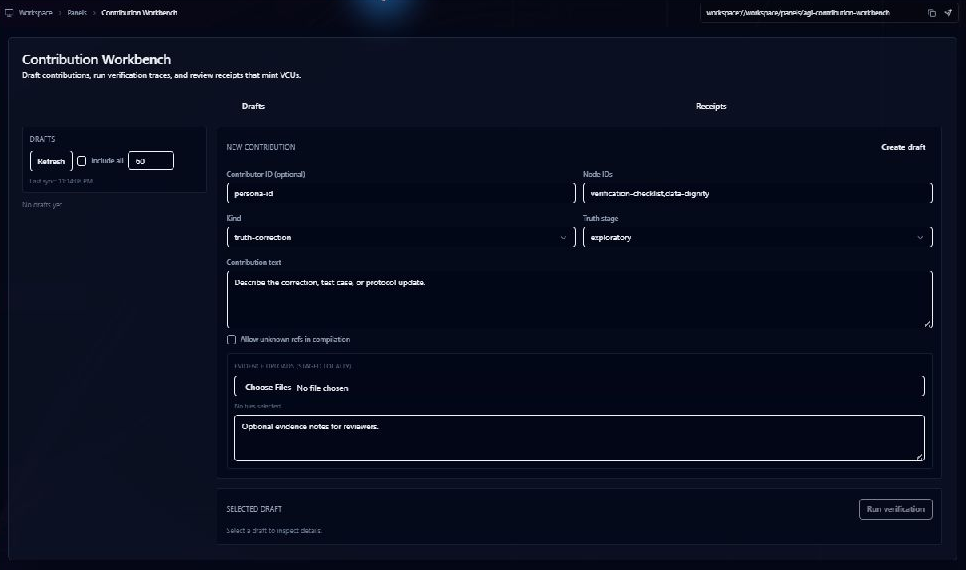

# CasimirBot

CasimirBot is a Windows research workstation and environment harness for working with AI inside real software. Its desktop brings together scientific tools, evidence views, account and connection checkpoints, and governed links to external programs. A supported AI client can inspect an admitted capability, receive an observation, and request a bounded operation when the account, program owner, and connector allow it.

The [website](https://casimirbot.com/) handles CasimirBot account identity and public release information. The [download page](https://casimirbot.com/download) is the source for the signed Windows installer and its current publisher and checksum. These desktop screenshots come from **R173, R176, and R177 isolated private developer builds**. They show dated test workflows; they are not evidence that the public installer exposes every panel or that every connection is ready.

## Website identity and the installed workspace

The [website](https://casimirbot.com/) introduces the download and account paths. Its October 17 Home capture describes CasimirBot as a download-first workspace for people, agents, and programs. Check the live [download page](https://casimirbot.com/download) for release availability, publisher, and installer checksum; the image is a dated view.

The October 18 download-page capture shows the separate public installer listing for **0.1.0-alpha.23**, with publisher and SHA-256 displayed on the website. Check the [live download page](https://casimirbot.com/download) before downloading; this dated image is not an installer signature or local hash verification. The R173–R177 desktop images below are private developer builds, not this listed release.

The cropped account overview below shows generic signed-in status and next steps for the installed harness. It contains no email or installation identifier. Website sign-in establishes identity; linking an installation begins from Account & Sessions in the app when available. Sign-in alone does not grant AI, room, or program access. This dated capture does not show account creation, OAuth completion, or an AI client connection.

## How a workflow proceeds

1. **Open the desktop and check identity.** Account & Sessions shows whether the website account is connected to this installation. Website sign-in alone does not grant AI, room, device, or program authority.
2. **Choose the AI connection.** Agent Access separates local setup, OAuth or protected client presence, exact task pairing, tool catalog, and required tool checks. A person can use bounded personal tools without a hosted-room subscription; a Message Codex task connection has its own owner-approved pairing.
3. **Check the environment.** Device Check shows connector identity, freshness, and local readiness. A Ready tunnel or supervisor does not prove that a remote client has authenticated, a device is paired, or an effect is allowed.
4. **Ask for an observation or bounded action.** The AI client selects an available capability. CasimirBot checks identity, context, consent, and scope, then returns an observation or a typed result with postcondition evidence. Where a prerequisite is missing, the workflow should report that failure rather than inventing a successful action.
5. **Inspect the evidence.** Research panels distinguish inputs, diagnostic models, calculated results, and verification receipts. A badge or screenshot does not establish a physical result.

The October 18 **R176 private build** starts from Home with free personal tools, a user-owned AI connection, hosted rooms, and planned CasimirBot-managed AI. Its [dated Home capture](images/casimirbot-r176-home-2026-10-18.jpg) shows read-only Adapter AI activity, with no current exact-task binding or verified run. The private environment catalog was unavailable in this isolated profile. The Minecraft Adapter tile is a developer path, not permission for player actions.

The later **R177 unpacked private build** kept those four Home paths and still showed the environment catalog unavailable in its isolated profile. Account & Sessions showed the website account connected to that installation; the selected Personal Codex local entry in Agent Access still reported `build_unavailable` with no verified current exact-task binding. Device Check showed 0 paired devices, no credentials projected, and the local tunnel stopped. In this unpacked build, Desktop Updates said there was **no installed update channel**. That state is not a signed-installer or public update-channel result.

R176 Desktop Updates showed the private development channel, R176 running, and R175 retained for rollback. This is a private-build state, not a signed public installer or a public update-channel acceptance result. Agent Access separately showed `build_unavailable` for the selected Personal Codex local entry and no verified current exact-task binding; Device Check showed 0 paired devices, no credentials projected, and its read-only local tunnel stopped.

The R173 Agent Access crop shows a real checkpoint state: the selected Personal Codex local entry reported `build_unavailable`, with the protected client read unverified. Saved pairing history and a locally Ready tunnel are separate from that selected route. The private conversation and pairing details are excluded from the image.

The R173 Device Check crop shows **0 paired devices**, **no credentials projected**, and a locally Ready developer tunnel. Its `Full developer MCP` label describes the local tunnel mode. The panel directs remote MCP check-in to Agent Access; this screenshot does not show a remote client check-in, a paired device, or permission for an external program action.

## What people can explore

The Home view groups **free personal tools**, **your AI connection**, **hosted rooms**, and a planned CasimirBot-managed AI path. Hosted collaboration and managed AI have separate release and account conditions. The workstation also contains research views such as Star Watcher, Theory Badge Graph, and Contribution Workbench.

The R173 Contribution Workbench crop shows a blank draft: a researcher can choose a node and truth stage, describe a contribution, and stage evidence and review notes. **Run verification** is disabled in this pictured state. The image is not a verification receipt or an accepted scientific claim.

CasimirBot's warp and propulsion studies are research and simulation. This page makes no claim of a working propulsion device. Minecraft is a technical reference environment for connector development; showing its code or setup path does not grant game actions or establish an approved paid Minecraft feature.

## Open source and the private platform repository

The historical full-platform repository remains private while its reachable history, imported material, credentials and runtime data, and file rights are reviewed. The current approach publishes reviewed first-party components from clean histories, with exact source inventories and component licenses. These public repositories are available now:

| Public repository | Scope |
| --- | --- |
| [Environment connector kit](https://github.com/pestypig/casimirbot-environment-connector-kit) | MIT-licensed contracts, transport helpers, synthetic and read-only examples, and mock. |
| [Verifier source](https://github.com/pestypig/casimirbot-verifier-source) | MIT-licensed Shadow of Intent SDK, CLI, and scaffolder source. |
| [Shared TypeScript preview](https://github.com/pestypig/casimirbot-shared-source-preview) | Selected shared contracts, policies, research metadata, and tests. |
| [Desktop host preview](https://github.com/pestypig/casimirbot-desktop-source-preview) | Selected Electron host and native Windows clock bridge source. |
| [Web-client preview](https://github.com/pestypig/casimirbot-web-client-source-preview) | Selected React/TypeScript UI and tests. |
| [Discord preview](https://github.com/pestypig/casimirbot-discord-source-preview) | Selected transport and voice-worker source. |

Each source repository describes its own build limits and third-party notices. The larger source-only previews are for inspection and reuse, not independently runnable CasimirBot installations. The public [Agent Access guide](https://casimirbot.com/agent-access) describes supported account-scoped connections; [public reasoning context](https://casimirbot.com/llms.txt) can be read without a private connection.

This repository is a **platform overview, not the application source or installer**. Its screenshots are illustrative product captures and are not covered by the MIT code licenses in the linked source repositories.
